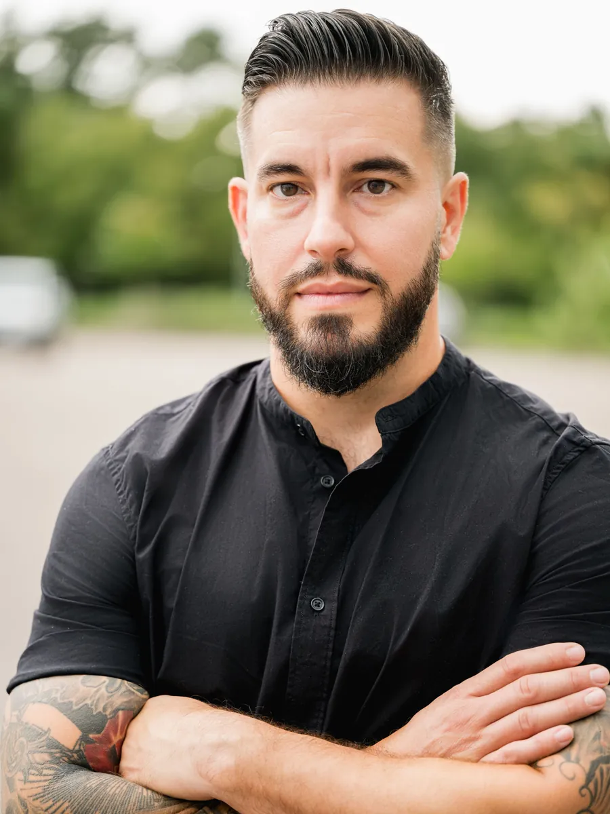

October was our biggest month yet. We held our first fundraiser, premiered *Last Thread* online, introduced our lead, and made a big decision about our timeline. Here's what happened.

## Our First Fundraiser

On October 10, we gathered at Burns Court Cinemas in Sarasota for our first live fundraising event. Ava Abreu, our production coordinator, and I talked through the story, the history behind it, and where production stands. We screened *Last Thread* and our Meet the Filmmakers video, then opened the floor for questions. The event raised **close to $1,000** for the film.

Thank you to everyone who came, and to Burns Court Cinemas and the Sarasota Film Society for hosting us.

## *Last Thread* Is Online

  

    <iframe src="https://www.youtube.com/embed/8HGDw1lh20c?rel=0&modestbranding=1&iv_load_policy=3" title="Last Thread" style="position: absolute; top: 0; left: 0; width: 100%; height: 100%; border: none;" allow="accelerometer; autoplay; clipboard-write; encrypted-media; gyroscope; picture-in-picture; web-share" allowfullscreen></iframe>
  

On October 18, *Last Thread* premiered on our YouTube channel. It's the short Meilín and I made on the Isla de la Juventud in 2025. It was an Official Selection at FilmGate Miami and the Lift-Off Global Network, and received an Honorable Mention at Films That Move. If you missed it at the event, [watch it here](https://www.youtube.com/watch?v=8HGDw1lh20c).

## Meet Our Cole

[Tony Palles](https://elpinerofilm.com/cast-and-crew/) will play Cole, our lead. Tony was born in Tampa, has Cuban and Puerto Rican heritage, and started acting at 40. He won Best Lead Actor at the Orlando International Film Festival for both *Forest of Fools* and *Baby Teeth*. We're thrilled to have him.

## A New Timeline

To shoot this film the way it's meant to be shot, and to give ourselves the time to raise the funds and support it needs to succeed, we've made the tough decision to move principal photography to **summer 2027**.

## Our Conversation with Michael E. Neagle

  

    <iframe src="https://www.youtube.com/embed/AYp0d09Czv0?rel=0&modestbranding=1&iv_load_policy=3" title="Interview with historian Michael E. Neagle" style="position: absolute; top: 0; left: 0; width: 100%; height: 100%; border: none;" allow="accelerometer; autoplay; clipboard-write; encrypted-media; gyroscope; picture-in-picture; web-share" allowfullscreen></iframe>
  

On November 8, our full interview with Michael E. Neagle premiered on YouTube. Mike is Professor of History and Director of History and Political Science at Nichols College, and the author of *America's Forgotten Colony*, the book that anchors so much of our research. [Watch the interview here](https://www.youtube.com/watch?v=AYp0d09Czv0).

This is the first of what we hope will be many conversations. If you or someone you know has a connection to the Isle of Pines, whether family who settled there, old letters and photos, or research of your own, we'd love to hear from you at [elpinerofilm@gmail.com](mailto:elpinerofilm@gmail.com).

## See Where We Stand

We've added a budget tracker to our [support page](https://elpinerofilm.com/support/). Now you can see at a glance how much we've raised and how much we still need to get to the island. We'll keep it updated as we go, so check back and watch it grow.

## How You Can Help

Follow along on Instagram, Facebook, YouTube, and TikTok at @cubaxfilm. If you're able to give, [donations are tax-deductible](https://www.paypal.com/donate/?hosted_button_id=Q5CKGFCV9H94G) through our fiscal sponsor, From the Heart Productions. And if you know a business or individual who might want to be part of the film in a bigger way, our [sponsorship tiers](https://elpinerofilm.com/sponsor) run from $250 to $2,000.

Gracias a todos.

— Robert
