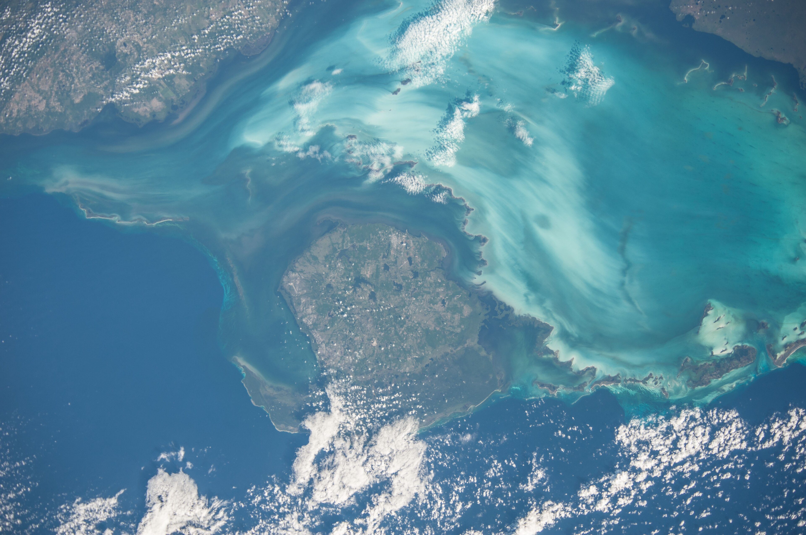
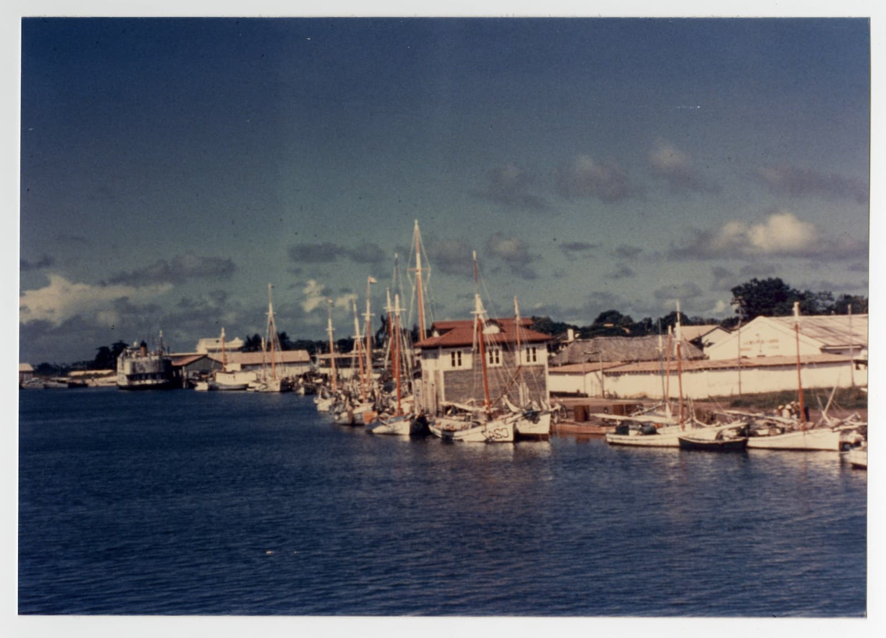

  <iframe src="https://www.youtube-nocookie.com/embed/AYp0d09Czv0" title="Interview with historian Michael Neagle (YouTube)" style="position: absolute; top: 0; left: 0; width: 100%; height: 100%; border: 0;" allow="accelerometer; autoplay; clipboard-write; encrypted-media; gyroscope; picture-in-picture; web-share" referrerpolicy="strict-origin-when-cross-origin" allowfullscreen loading="lazy"></iframe>

About thirty miles off Cuba's southwest coast lies an island most people have never heard of. Over the years, it has gone by many names. The Spanish called it Isla de Pinos — the Isle of Pines. Cuban writers called it La Isla Olvidada — the forgotten island. Locals, worn down by centuries of names, called it the Island of a Thousand Names. American land promoters marketed it as the real-life Treasure Island of Robert Louis Stevenson, leaning into its reputation as a pirate haven and a place of buried fortune. In 1978, Fidel Castro renamed it the Isla de la Juventud — the Isle of Youth. That name has mostly stuck. But the older names say something truer about the place: it has always been easier to project a story onto this island than to know it.

The pirate reputation, at least, was not just marketing. For roughly two centuries the island's uninhabited south coast sheltered pirates, smugglers, and escaped slaves who found Spanish authorities easy to avoid there, a history preserved today only in a handful of coves still bearing names like Purgatory Cove, Devil Cove, and Treasure Lagoon, the same stretch of coastline some still claim inspired Robert Louis Stevenson's Treasure Island, though a few other islands make that same claim. Henry Morgan, the most notorious pirate ever to sail the Caribbean, staged part of his fleet off this coast in 1668 before launching a raid on the Cuban town of Puerto Príncipe. By the early 1800s, the entire island had come under the control of one such figure, a smuggler known as Pepe el Mallorquín, whose crew's raids on Cuban shipping grew so brazen that in 1822 two English warships hunted them down and wiped them out. England warned Spain that if it could not control its own island, England would. Six years later, in 1828, Spain finally sent troops, along with a contingent of prisoners to help build the garrison, and founded the settlement that became Nueva Gerona.

That garrison set the pattern for most of what followed. For the next century, this remained a sparsely populated island, one Spain mostly used as a place to send criminals and political prisoners, a reputation that stifled serious development for generations. Even José Martí, Cuba's National Hero, was exiled there. Yet even at its most overlooked, the island attracted a strange kind of outside ambition: in 1838, Belgium's King Leopold I seriously explored buying it outright from Spain, envisioning a Caribbean foothold for a new commercial empire. The deal collapsed over concerns about the island's shallow harbors. The island was peripheral, isolated, a footnote — and yet, somehow, never entirely forgettable.

That began to change after the Spanish-American War of 1898. Some in Washington saw the island as a potential naval base and argued the United States should simply purchase it. But the surrounding waters proved too shallow, and Guantánamo Bay offered a far better harbor. The strategic interest faded. A commercial one took its place. In the ambiguous years that followed, the island's political status was left deliberately unresolved. A treaty signed in 1904 recognized Cuban sovereignty, but the United States Senate declined to ratify it — leaving the island in a kind of diplomatic limbo for more than two decades. Into that limbo came Americans.

Land companies advertised the Isle of Pines in newspapers across the United States — in Ohio, Wisconsin, Indiana, Florida — as a tropical paradise ready to be farmed. They sold the climate, the soil, the citrus groves, and the proximity to American markets. Thousands of settlers came. At the peak of the American presence, around the 1910s, perhaps as many as two thousand U.S. citizens lived on the island. By some estimates, Americans had purchased close to ninety percent of the island's arable land. They founded roughly a dozen towns, built farms and groves, established churches, schools, and social clubs. An English-language newspaper operated for years. A private school — the American Central School — offered instruction from grade school through high school, drawing students from across the island, many of them Cuban families who wanted their children to learn English.

<!-- PHOTO 3: mid-history -->

Life was harder than the land companies had promised. Clearing land, planting groves, and building in a tropical climate proved more expensive and more exhausting than most settlers had anticipated. Many businesses failed. Hurricanes damaged or destroyed what settlers had built. Most who came eventually left, disillusioned. But some stayed — and those who stayed long enough often developed a deep attachment to the island, its landscape, and its people.

In 1925, the United States finally ratified Cuban sovereignty over the island. The annexationist dream was over. The American community gradually contracted. When the Cuban Revolution came in 1959, most of the remaining settlers left quickly. Properties were nationalized. The school closed. The newspaper folded. But the departure was not absolute. A few Americans stayed on. A decade into the Revolution, fewer than a dozen remained. The last of them, Harry Koenig — born in the United States to parents who had settled on the island in 1909 — died there in 1995. With him, a presence that had lasted nearly a century ended.

What remained was a cemetery. Founded in 1907 in the settlement of Columbia — the first town established by American arrivals — the American Cemetery holds the graves of roughly two hundred U.S. citizens who lived and died on the island. There is no sign at the entrance, no monument, no historical marker. The headstones are weathered. Many are cracked or faded. The wooden fence posts that once marked the boundary have mostly rotted away. It is, in the words of one historian, a largely forgotten place.

*El Pinero* begins, in a sense, at that cemetery.

---

### Further Reading

The history behind this film is documented history. For those who want to go deeper, these are the sources we keep returning to:

**Michael Neagle, [*America's Forgotten Colony: Cuba's Isle of Pines*](https://www.amazon.com/Americas-Forgotten-Colony-Cambridge-Relations/dp/1316502015){:target="_blank"} (Cambridge University Press, 2016)** — the definitive scholarly account of the American presence on the island, from the land companies of the early 1900s to the last settlers.

**Jane McManus, [*Cuba's Island of Dreams: Voices from the Isle of Pines and Youth*](https://www.amazon.com/Cubas-Island-Dreams-Voices-Pines/dp/0813017416){:target="_blank"} (University Press of Florida, 2000)** — an oral history built from the voices of the people who lived it: American settlers, native pineros, and the Jamaican and Caymanian families who made the island's southern coast their home. It includes testimony from the last American on the island.

**Morton D. Winsberg, [*The Isle of Pines, Cuba: A Geographic Interpretation*](https://archive.org/details/isleofpinescubag00winsrich){:target="_blank"} (PhD dissertation, University of Florida, 1958)** — a geographer's on-the-ground study from the tail end of the American period, covering the island's landscape, economy, and population in more granular detail than any other source we've found. Freely available online.

**Irene A. Wright, [*Isle of Pines*](https://catalog.hathitrust.org/Record/009832907){:target="_blank"} (1910)** — a journalist's firsthand account, written at the height of the American colony. Long out of print, it can be read free online.
