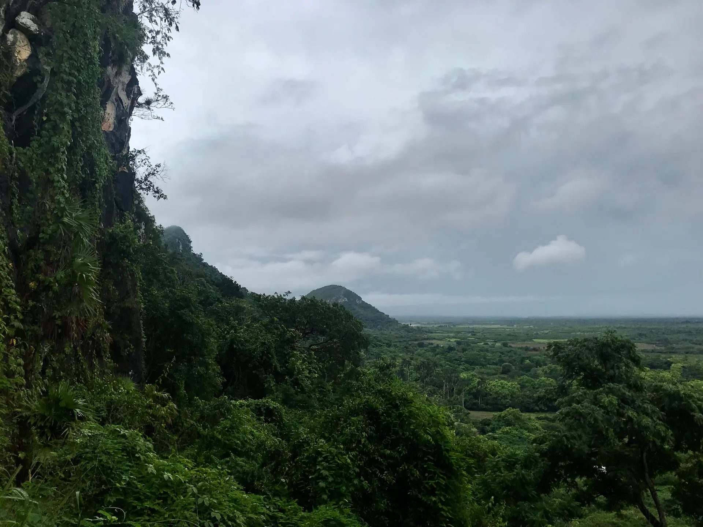

  

    
    
    
    

    

  

  

    

      To fulfill his father's last wish, a young American man travels to
      Isla de la Juventud, Cuba. But as he journeys deeper into the island,
      the search for his grandfather's grave opens the door to a family
      history he never knew.
    

    

      <em>El Pinero</em> — a short film by Robert Potter and Meilín Quilez Durañona
    

    

    

      <a href="/support/" class="home-btn home-btn-hero">Support The Film</a>
    

  

<section class="home-section" aria-labelledby="home-filmmakers">
  

    
The Filmmakers

    <h2 id="home-filmmakers">From Florida to the Isla de la Juventud</h2>
    
<em>El Pinero</em> is a true Cuban–American collaboration. Its cast and crew come from both sides of the Florida Straits, telling a story of the two countries' shared past from both perspectives.

    

      

        
        <h3>Robert W. Potter</h3>
        
Writer / Producer

        
<a href="https://www.instagram.com/robertthepotter" target="_blank" rel="noopener" aria-label="Robert W. Potter on Instagram"><svg xmlns="http://www.w3.org/2000/svg" viewBox="0 0 24 24" width="14" height="14" fill="currentColor"><path d="M12 2.163c3.204 0 3.584.012 4.85.07 3.252.148 4.771 1.691 4.919 4.919.058 1.265.069 1.645.069 4.849 0 3.205-.012 3.584-.069 4.849-.149 3.225-1.664 4.771-4.919 4.919-1.266.058-1.644.07-4.85.07-3.204 0-3.584-.012-4.849-.07-3.26-.149-4.771-1.699-4.919-4.92-.058-1.265-.07-1.644-.07-4.849 0-3.204.013-3.583.07-4.849.149-3.227 1.664-4.771 4.919-4.919 1.266-.057 1.645-.069 4.849-.069zm0-2.163c-3.259 0-3.667.014-4.947.072-4.358.2-6.78 2.618-6.98 6.98-.059 1.281-.073 1.689-.073 4.948 0 3.259.014 3.668.072 4.948.2 4.358 2.618 6.78 6.98 6.98 1.281.058 1.689.072 4.948.072 3.259 0 3.668-.014 4.948-.072 4.354-.2 6.782-2.618 6.979-6.98.059-1.28.073-1.689.073-4.948 0-3.259-.014-3.667-.072-4.947-.196-4.354-2.617-6.78-6.979-6.98-1.281-.059-1.69-.073-4.949-.073zm0 5.838c-3.403 0-6.162 2.759-6.162 6.162s2.759 6.163 6.162 6.163 6.162-2.759 6.162-6.163c0-3.403-2.759-6.162-6.162-6.162zm0 10.162c-2.209 0-4-1.79-4-4 0-2.209 1.791-4 4-4s4 1.791 4 4c0 2.21-1.791 4-4 4zm6.406-11.845c-.796 0-1.441.645-1.441 1.44s.645 1.44 1.441 1.44c.795 0 1.439-.645 1.439-1.44s-.644-1.44-1.439-1.44z"/></svg></a> <a href="https://www.linkedin.com/in/robertwpotter/" target="_blank" rel="noopener" aria-label="Robert W. Potter on LinkedIn"><svg xmlns="http://www.w3.org/2000/svg" viewBox="0 0 24 24" width="14" height="14" fill="currentColor"><path d="M20.447 20.452h-3.554v-5.569c0-1.328-.027-3.037-1.852-3.037-1.853 0-2.136 1.445-2.136 2.939v5.667H9.351V9h3.414v1.561h.046c.477-.9 1.637-1.85 3.37-1.85 3.601 0 4.267 2.37 4.267 5.455v6.286zM5.337 7.433c-1.144 0-2.063-.926-2.063-2.065 0-1.138.92-2.063 2.063-2.063 1.14 0 2.064.925 2.064 2.063 0 1.139-.925 2.065-2.064 2.065zm1.782 13.019H3.555V9h3.564v11.452zM22.225 0H1.771C.792 0 0 .774 0 1.729v20.542C0 23.227.792 24 1.771 24h20.451C23.2 24 24 23.227 24 22.271V1.729C24 .774 23.2 0 22.222 0h.003z"/></svg></a>

      

      

        
        <h3>Meilín Quilez Durañona</h3>
        
Director / Producer

        
<a href="https://www.instagram.com/meilinquilez/" target="_blank" rel="noopener" aria-label="Meilín Quilez Durañona on Instagram"><svg xmlns="http://www.w3.org/2000/svg" viewBox="0 0 24 24" width="14" height="14" fill="currentColor"><path d="M12 2.163c3.204 0 3.584.012 4.85.07 3.252.148 4.771 1.691 4.919 4.919.058 1.265.069 1.645.069 4.849 0 3.205-.012 3.584-.069 4.849-.149 3.225-1.664 4.771-4.919 4.919-1.266.058-1.644.07-4.85.07-3.204 0-3.584-.012-4.849-.07-3.26-.149-4.771-1.699-4.919-4.92-.058-1.265-.07-1.644-.07-4.849 0-3.204.013-3.583.07-4.849.149-3.227 1.664-4.771 4.919-4.919 1.266-.057 1.645-.069 4.849-.069zm0-2.163c-3.259 0-3.667.014-4.947.072-4.358.2-6.78 2.618-6.98 6.98-.059 1.281-.073 1.689-.073 4.948 0 3.259.014 3.668.072 4.948.2 4.358 2.618 6.78 6.98 6.98 1.281.058 1.689.072 4.948.072 3.259 0 3.668-.014 4.948-.072 4.354-.2 6.782-2.618 6.979-6.98.059-1.28.073-1.689.073-4.948 0-3.259-.014-3.667-.072-4.947-.196-4.354-2.617-6.78-6.979-6.98-1.281-.059-1.69-.073-4.949-.073zm0 5.838c-3.403 0-6.162 2.759-6.162 6.162s2.759 6.163 6.162 6.163 6.162-2.759 6.162-6.163c0-3.403-2.759-6.162-6.162-6.162zm0 10.162c-2.209 0-4-1.79-4-4 0-2.209 1.791-4 4-4s4 1.791 4 4c0 2.21-1.791 4-4 4zm6.406-11.845c-.796 0-1.441.645-1.441 1.44s.645 1.44 1.441 1.44c.795 0 1.439-.645 1.439-1.44s-.644-1.44-1.439-1.44z"/></svg></a> <a href="https://meilinquilez.substack.com" target="_blank" title="Substack" style="font-family: Georgia, serif; font-weight: bold; font-size: 1em; color: currentColor; text-decoration: none; margin-left: 8px; vertical-align: middle;" rel="noopener" aria-label="Meilín Quilez Durañona on Substack">S</a>

      

    

    
Principal photography is planned for <strong>summer 2027</strong> on location on the Isla de la Juventud.

    

      <a href="{{ '/cast-and-crew/' | relative_url }}" class="home-btn">Meet the Full Cast &amp; Crew</a>
    

  

</section>

<section class="home-section home-section-dark" aria-labelledby="home-history">
  

    
The History

    <h2 id="home-history">America's Forgotten Colony</h2>
    

      
      

        
In the early 1900s, while the island's political status sat unresolved, American land companies sold Cuba's Isle of Pines as a tropical paradise ready to be farmed. Thousands of settlers came. At the peak, perhaps two thousand Americans lived there, founding roughly a dozen towns with their own churches, schools, and an English-language newspaper.

        
Most eventually left. In 1925 the United States recognized Cuban sovereignty over the island, and after the 1959 Revolution nearly all who remained went home. The last of them died there in 1995. What is left is a weathered cemetery holding the graves of some two hundred Americans, and that is where <em>El Pinero</em> begins.

      

      
In the early 1900s, as many as two thousand Americans settled Cuba's Isle of Pines. Nearly all of them eventually left. What remains is a weathered cemetery holding some two hundred American graves, and that is where <em>El Pinero</em> begins.

    

    

      <a href="{{ '/film/' | relative_url }}" class="home-btn">Learn the History</a>
    

  

</section>


<section class="home-section" aria-labelledby="home-updates">
  

    
Updates

    <h2 id="home-updates">Follow Along</h2>
    
    <a class="home-update" href="{{ latest.url | relative_url }}">
      
      

        Latest &middot; {{ latest.date | date: "%B %-d, %Y" }}
        <h3>{{ latest.title }}</h3>
        
{{ latest.subtitle }}

      

    </a>
    
    

      <a href="{{ '/blog/' | relative_url }}" class="home-btn">Read All Updates</a>
    

  

</section>

